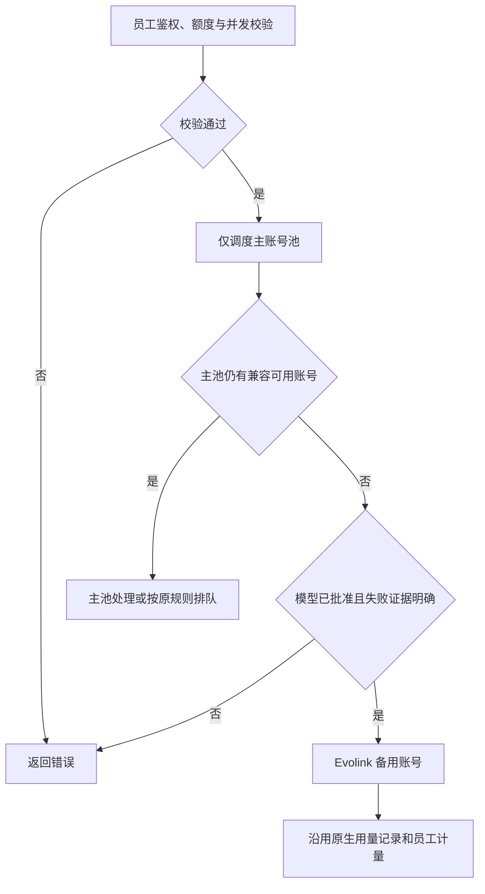

# Evolink 受控兜底

## 范围与触发条件

工作台和详情页继续调用 Sub2API。Evolink 作为 Sub2API 的 OpenAI API Key 账号接入，不向客户端提供供应商凭据。

首期只允许 `gpt-6-luna` 和 `gpt-image-2.5-flare` 同名模型，覆盖文本、文生图、带参考图 URL 的 JSON 图生图。不会自动改用其他模型。WebSocket、带 `previous_response_id` 的续链、压缩、流式图片与 multipart 文件上传不进入兜底。

每次调度先排除标记为 `extra.workbench_evolink_fallback=true` 的账号，执行原生主账号池调度。仍有满足模型和能力要求的主账号时，即使并发满载也不会进入 Evolink。主池恢复后，新请求重新优先使用主池，备用账号的粘性绑定不会覆盖主池。

只有主池没有兼容且可调度的账号，或本次请求已尝试的主账号全部被明确的鉴权／限流响应拒绝时，才允许进入备用池。明确准入失败包括上游 401、429，以及具有账号停用错误码的 403。普通 403、内容安全拒绝、参数错误、传输错误和不确定的 5xx 不允许本次请求跨供应商重试。员工自身的额度、并发、Key 和权限校验先于调度，不能通过兜底绕过。

## 图片协议与计量

Evolink 图片接口提交到 `/v1/images/generations`，返回任务 ID，再通过 `/v1/tasks/{id}` 查询。适配层将工作台解析出的参考图 URL 转成 `image_urls`，同一个生成请求只提交一次；轮询失败、超时、任务失败或用量异常都不重新提交。原生调用上下文、出站代理、账号并发和员工并发租约保持生效。

图片完成后将结果转换为 OpenAI 图片响应。员工 Token 以完成任务返回的 `total_tokens`、`image_output_tokens` 及缓存字段为事实来源；预扣 Credits 不能当成 Token。供应商原始用量、Credits 成本和任务 ID 随响应进入已有审计。完成任务缺少有效 Token 用量时明确报错，需对账处理，不报零 Token 成功。

## 源码与开关

扩展以已核验生产源码提交 `9a2511261d93198fd7d599b9247730b92c770862` 为基线，保留既有工作台扩展。运行 `python3 integrations/sub2api-workbench/apply_evolink.py <生产源码检出目录>`；脚本会先检查全部插入文件的 SHA256，再修改源码。它与面向干净上游的 `apply.py` 不可混用。

`WORKBENCH_EVOLINK_FALLBACK_ENABLED=true` 才允许启用兜底。未开启时，已标记的备用账号仍被主池排除。账号同时限制模型白名单、目标分组、并发和优先级；低优先级只是辅助配置，不能替代主池故障判断。

实际连接入口、账号 ID 和凭据来源只记录在个人环境文件。供应商 Key 只从凭据设施或受限配置读取，不放入源码、命令参数、测试报告和构建清单。

## 验证与发布

需验证主池正常、主池无账号、明确鉴权失败、并发满载、内容拒绝、连接不确定失败、主池恢复、图片轮询、缓存计量和员工限额拒绝。模拟上游只用于确定性分支回归，真实文本、文生图和图生图须分别核对结果和用量。

发布前从独立源码提交构建完整中转制品，运行服务与中间件回归及工作台扩展数据库测试，按工程发布流程构建嵌入原生管理界面的完整二进制。新账号配置默认禁用，确认制品及配置一致后启用；回滚使用旧完整制品，并先停用备用账号，避免旧调度器将其作为普通账号分流。

本文件描述已确认的目标行为，实际启用状态以环境发布记录和验收结果为准。
