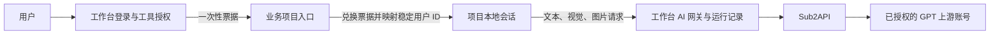

# 其他项目接入工作台与 AI 中转：详情页改造复用手册

本手册供下一个已有独立登录和 AI 能力的项目接入 AI 工作台时使用。它记录详情页改造中已经实施的协议、执行顺序、验收方法和故障经验。新项目须先完成自己的调用清单与身份映射设计；本文中的工具标识、模型名、超时和例外仅是详情页实例，不能直接当作新项目配置。

维护详情页时，仍以[工作台侧协议](详情页单入口灰度说明.md)和[详情页侧协议](../../../detailPage/docs/工作台接入与用户映射.md)为准。执行部署前，应核对工程文档与实际运行方式；详情页较早的部署说明包含迁移前配置，不能不经核对直接照用。本文不保存环境地址和凭据。

## 一、先确定改造范围

在修改代码前，分别列出入口、身份、数据和每一条模型调用。不能只搜索 GPT 或 Gemini SDK：详情页的文本调用还藏在 Nexhina、EVOLINK、豆包等旧封装名中，图片调用也有文生图、图生图、素材生成和视觉分析等路径。

| 清单 | 每条记录至少写明 | 详情页实例 |
| --- | --- | --- |
| 登录入口 | 页面、API、历史会话、回调、跳转域名 | 工作台工具卡片是唯一入口；`/legacy-entry` 和本地密码登录停用 |
| 用户与数据 | 外部稳定 ID、本地用户 ID、角色、项目及素材归属 | `PlatformUserMapping` 一对一映射；本地项目和素材继续归本地用户 |
| AI 调用 | 用户操作、服务端入口、旧 SDK/封装、模型、输入格式、是否异步、权限和计量 | 外部文案、视觉理解、生图走工作台；百炼 Embedding 与 Google Cloud Vision 是明确例外 |
| 依赖与限制 | 上游账号权限、代理、并发、模型超时、返回结构 | 图生图需要图片编辑能力；文本生成曾超过 120 秒 |

盘点时同时搜索路由、封装函数、环境变量、定时任务和后台脚本。把「明确保留直连」「经工作台」「非模型请求」逐项标明，并请业务方确认例外。详情页的图片上传、素材存储和本地 OCR 不属于外部模型调用。

## 二、目标链路与职责

工作台负责登录身份、工具与外层项目授权、模型调用、用量和运行审计。业务项目负责本地业务权限、业务项目、素材及结果。外层项目只约束票据和审计范围；详情页没有把工作台项目映射成本地项目。新项目若要做项目映射，须单独设计迁移与权限规则。

详情页使用以下协议，供新项目设计对照：

1. 工作台验证用户的工具权限。工具卡片未指定项目时，工作台创建隐藏的个人工具项目；显式项目任务沿用所选项目。
2. 工作台通过 `POST /api/tool-sessions/detail-page-entry` 签发 `detail-page-sso` 票据，并跳转业务项目 `/platform-entry?ticket=...`。
3. 业务项目用服务凭据调用 `/api/tool-sessions/exchange`，再调用 `/api/tool-sessions/introspect`，核对用户、工具和项目范围后创建本地会话。票据只可在 60 秒内兑换一次。
4. 业务项目按工作台用户稳定 ID 查一对一映射。存量用户保留原角色、项目和素材；未映射用户按事先定义的规则创建。不得按姓名或邮箱自动合并。
5. 本地会话绑定工作台工具会话。详情页定期重新内省，并在 AI 调用前确认上下文；会话过期或范围变化时要求用户从工作台重新进入。
6. 旧密码入口、旧跳转入口和旧本地密码会话均不能访问业务接口。票据失败时返回明确错误，不能回退旧登录。

票据和工具会话不写入浏览器本地存储，也不以明文写入数据库。详情页加密保存工具会话；轮换会话密钥会使旧工具会话失效。跳转使用项目公开域名，不能把反向代理内部地址暴露给浏览器。

## 三、统一 AI 调用的实现边界

详情页把旧文本封装统一导向 `workbenchChatCompletion`，把图片生成导向 `workbenchImageGeneration`。网关请求先创建工作台运行记录，完成后回写成功或失败；详情页仍保留本地操作和结果审计。已经由工作台计量的模型调用，不在详情页重复扣本地积分。

| 能力 | 详情页调用工作台 | 工作台转发中转 | 关键校验 |
| --- | --- | --- | --- |
| 文案、视觉理解 | `/api/ai/chat/completions` | GPT 文本模型；支持图片输入 | 既测纯文本，也测带图消息；模型名称和类型精确匹配已启用配置 |
| 文生图 | `/api/ai/images/generations` | `/v1/images/generations` | 确认账号有生图权限，并取得可用图片结果 |
| 图生图、重画 | 同上，参数包含参考图 | `/v1/images/edits`，传 `images[].image_url` | 上游必须支持图片编辑和参考图格式 |
| 异步图片结果 | `/api/ai/tasks/{taskId}` | 查询对应任务 | 轮询必须有超时、失败状态和用户可见错误 |

详情页实例使用 `gpt-6-luna` 和 `gpt-image-2.5-flare`。新项目必须从中转站实际可用模型和账号权限反推配置，不能只改环境变量。工作台对该工具按模型名称和类型精确匹配 `provider=sub2api`；缺模型、超额度、无权限、会话失效或上游失败时直接返回错误。不能暗中切回 Gemini、旧服务商、旧直连地址，也不能用本地拼接结果冒充 AI 成功。

环境配置应只列键名和用途，不写真实值。详情页的关键键为 `WORKBENCH_INTEGRATION_ENABLED`、`WORKBENCH_BASE_URL`、`DETAIL_PAGE_PUBLIC_URL`、`WORKBENCH_SERVICE_CREDENTIAL`、`WORKBENCH_SESSION_SECRET`、`WORKBENCH_GPT_TEXT_MODEL` 和 `WORKBENCH_GPT_IMAGE_MODEL`。工作台服务凭据的实际生效值必须与业务项目一致；工作台同时存在新旧凭据变量时，核对覆盖顺序和最终值。

## 四、按顺序实施

1. **冻结现状。** 记录两个项目与中转站的源码提交、当前制品、数据库结构、权限配置和回滚点；对每一条 AI 调用填写清单。确认哪些能力允许保留直连。
2. **设计身份映射。** 确定稳定用户 ID、存量账号匹配清单、冲突处理、首次登录默认角色、本地数据归属。先以只读或 dry-run 方式检查重复、缺失与冲突，再应用映射。详情页的映射脚本只写身份映射，不搬动业务数据。
3. **接入唯一入口。** 实现工作台工具授权、票据、业务项目票据兑换、本地会话绑定与定期内省。拒绝旧登录和旧会话，并验证无票据、重复票据、过期票据、工具或项目不匹配的请求。
4. **收敛模型调用。** 逐条替换真实调用路径，覆盖文本、视觉、文生图、图生图、后台任务。旧封装名称可以暂时保留，但实现必须统一走网关。移除失败后的旧提供方回退，并校正计量和错误显示。
5. **配置上游。** 在中转站确认模型、账号权限、代理出口、并发和额度。先测真实文本、视觉输入、文生图和图片编辑；健康接口通过不代表模型可用。
6. **构建与发布。** 从可追溯源码提交构建完整制品。保留旧完整制品；仅在修改受限环境配置时备份原配置。若发布包含数据库结构变更、数据迁移、回填或其他发布期数据写入，先备份受影响的数据库并验证备份可读；没有数据库变更时不备份数据库。按工程文档发布中转站、工作台和业务项目，并记录提交与制品哈希。禁止替换单个 `.class` 或向 JAR 注入补丁。
7. **验收并留证。** 使用普通员工账号从工作台进入，逐项完成真实生成，并对应核对业务结果、工作台运行记录和中转站请求记录。单独验证明确保留直连的能力及其计量口径。

若源码工作区混有未确认改动、完整构建失败或生产代码无法对应提交，停止发布，先整理提交边界。回滚使用同一发布点的旧完整制品；本次执行过数据库变更且需要恢复数据时，再使用对应备份。关闭工作台集成开关不是恢复旧登录的办法。

## 五、验收矩阵与完成标准

| 场景 | 预期证据 |
| --- | --- |
| 正常入口 | 工作台授权、票据兑换、稳定用户映射、本地权限及业务数据正确 |
| 非法入口 | 旧登录、旧入口、无票据、过期或重复票据、旧会话被拒绝 |
| 文本与视觉 | 页面得到真实结果；工作台运行记录成功；中转站有对应 GPT 请求 |
| 文生图与图生图 | 返回真实图片；分别核对生成和编辑接口、模型与账号 |
| 错误路径 | 模型缺失、账号无权限、额度、并发、上游失败可见；无旧提供方回退 |
| 权限差异 | 用有权限的账号验收每项功能；403 只证明门禁生效，不证明模型链路成功 |
| 例外能力 | 逐项验证保留直连的功能、用量口径和失败行为 |
| 发布一致性 | 三端运行版本、源码提交、完整制品哈希、回滚制品和健康状态一致 |

完成标准是「调用清单中的每条适用路径都有真实结果与上下游记录」，而不是仅通过单元测试、页面跳转或健康检查。无法取得权限或测试账号的功能，应在验收记录中明确标为未覆盖。

## 六、详情页这次暴露的问题

| 现象 | 已查到的原因或边界 | 下个项目的处理方法 |
| --- | --- | --- |
| 长文案首次失败 | 工作台文本模型原超时为 120 秒；真实请求可能超过该值 | 先测典型长任务耗时；同时核对网关、应用、反向代理和上游超时。详情页本轮将工作台文本超时设为 240 秒，不能照搬为通用值 |
| 后续请求出现 429 | 当时员工中转并发限制为 1 | 验收时记录并发策略，区分容量限制与模型错误；避免并发测试污染功能结论 |
| 图片偶发 502 | 一次请求中，两个上游账号经代理连接均被重置；相同操作重试成功，根因仍未定 | 同时查业务项目、工作台、中转站、代理及上游日志。暂时性重试成功不能证明代理稳定 |
| 生图或编辑权限不一致 | 上游账号是否可调用模型取决于实际权限；账号可用不等于图片能力可用 | 按账号、模型和接口实测；不要用文本成功推断生图成功 |
| 配置改库后恢复旧值 | 工作台模型配置有进程内状态，保存时可能将旧值写回数据库 | 通过受支持的配置入口修改；必要时在停服务和备份后修改，并在重启后复核持久值 |
| 素材反推无法验收 | 验收用户的 `assetCaption` 权限关闭，接口返回 403 | 换有权限的账号验收；不要为测试而悄悄扩大生产用户权限 |
| 界面保留旧模型或服务商名称 | 部分文案和封装名仍沿用迁移前术语 | 把 UI 文案与源码命名加入迁移清单；以运行记录判断实际路由 |

本轮生产实测已覆盖工作台票据登录、14 屏文案、视觉分析、图片重画和素材文生图，且对应工作台与中转站记录。素材反推因账号权限未做真实模型验收；代理偶发连接重置仍需观察。百炼 Embedding 和 Google Cloud Vision 是本轮约定的直连例外，不应误报为漏接。

本轮生产验收的源码基线是工作台 `69e4c4d`、详情页 `cf9f2d5`、Sub2API `9a25112`。这是复盘用快照，不代表今后生产一直运行这些版本。详情页提交已推送至远端；工作台和中转站的远端源码同步仍须单独核对，不能用「已部署」代替「已推送」。

## 七、下一个项目的交付记录模板

复制下面的项目级清单，逐项填写证据。未验证的项目保持「未验证」，不要写成「通过」。

| 项目 | 填写内容 |
| --- | --- |
| 目标项目与三个仓库 | 工程路径、维护文档、分支、远端地址、负责人 |
| 登录与用户映射 | 旧入口、目标工具标识、稳定 ID、存量映射 dry-run 结果、冲突处理 |
| AI 调用清单 | 功能、路由、模型类型、旧提供方、目标模型、例外理由、业务权限 |
| 配置与容量 | 服务凭据核对结果、模型配置、账号权限、并发、超时、代理检查 |
| 构建与发布 | 源码提交、测试结果、完整制品哈希、备份与回滚位置 |
| 真实验收 | 文本、视觉、文生图、图生图、失败路径及三端记录对应关系 |
| 未覆盖与遗留 | 权限缺口、上游限制、代理问题、旧文案、下一步及责任人 |
