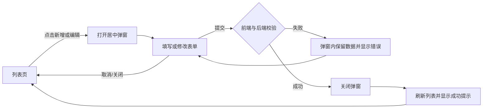

# 一起互动 AI 工作台前端视觉重构设计

## 1. 背景与目标

当前平台已经具备登录、工作台、项目、项目看板、运行记录、配置中心及外部 AI 工具入口等功能，但不同阶段新增的页面在字体层级、间距、卡片、表格、表单、弹窗和抽屉表现上存在差异；部分管理功能还使用列表右侧常驻编辑区，压缩了列表空间。

`doc/一期/前端demo/一起互动AI工作台` 是本次重构的正式 UI 稿，不是仅供参考的风格样例。本次采用“品牌化工作台 + 高效率后台列表”的混合方案，在不改变业务逻辑的前提下，让平台自有页面的布局和视觉表现对齐 UI 稿。

核心目标：

- 建立统一、克制且具有 AI 工作台识别度的视觉语言。
- 平台页面默认以列表和内容浏览为主，提升信息获取效率。
- 所有新增、编辑操作改为居中弹窗。
- 查看详情继续使用右侧侧滑面板，并与弹窗共享设计规范。
- 保持现有接口、权限、路由状态、数据结构和外部工具跳转逻辑不变。

## 2. 功能边界

### 2.1 本期范围

- 登录页。
- 工作台首页。
- 项目列表与项目详情。
- 项目看板。
- 运行记录列表与运行详情。
- 配置中心的部署、用户、组织、角色、工具、模型和操作日志页面。
- 公共侧边栏、页面标题区、筛选区、表格、状态标签、空状态、按钮、表单、弹窗、抽屉和反馈提示。
- 桌面端、平板及移动端的基础响应式适配。

### 2.2 不在本期范围

- 不修改任何后端接口或接口字段。
- 不修改权限判定、业务状态流转或数据校验规则。
- 不重构模型调用、统一网关、登录鉴权和外部 AI 工具接入逻辑。
- 不修改“推广图制作”等外部工具内部页面，只保留现有新页面打开方式。
- 不新增业务功能，不重新定义业务文案。
- 不进行压力测试。

### 2.3 视觉基准与优先级

- UI 稿目录：`doc/一期/前端demo/一起互动AI工作台`。
- 在相同浏览器视口下，以 UI 稿实际渲染结果作为视觉验收基准，而不是只比对本文中的抽象设计令牌。
- 页面布局、侧边栏、颜色、字体层级、间距、圆角、阴影、卡片、表格、筛选区、按钮和状态样式应与 UI 稿保持一致。
- 如果本文视觉描述与 UI 稿存在差异，以 UI 稿为准。
- 如果 UI 稿的静态交互与用户已确认的交互要求存在差异，以用户确认的交互为准：新增和编辑使用居中弹窗，查看详情使用右侧抽屉。
- 如果视觉调整与现有业务逻辑发生冲突，以保持现有接口、权限、数据和业务规则为前提，不通过伪造数据或绕过逻辑实现外观。

页面映射：

| 当前平台页面 | UI 稿基准 |
| --- | --- |
| 登录页 | `登陆页面.html` + `login.css` |
| 工作台首页与公共主框架 | `工作台主页.html` + `dashboard.css` |
| 项目 | `项目页面.html` + `dashboard.css` |
| 项目看板 | `项目看板页面.html` + `dashboard.css` |
| 运行记录及详情 | `运行记录页面.html` + `dashboard.css` |
| UI 稿未单列的配置中心页面 | 延续工作台主框架、项目和运行记录页面形成的同一套视觉系统 |

## 3. 设计方向

采用已确认的方案 C：“UI 稿视觉 + 后台高效交互”。

- 工作台首页强调品牌感，使用紫色叠层欢迎卡作为标志性视觉元素。
- 管理页面强调信息效率，使用清晰的标题、筛选、列表和分页结构。
- 装饰元素集中在首页与登录页，后台列表页保持克制。
- 页面不使用大面积渐变文字、过度透明玻璃效果或无意义动效。

## 4. 信息架构

```text
平台
├── 登录页
└── 主框架
    ├── AI 部门
    │   ├── AI 市场部
    │   ├── AI 设计部
    │   ├── AI 运营部
    │   ├── AI 人事部
    │   └── AI 内容部
    └── 通用
        ├── 项目
        ├── 项目看板
        ├── 运行记录
        └── 配置中心
            ├── 部署状态
            ├── 用户管理
            ├── 组织管理
            ├── 角色权限
            ├── 工具配置
            ├── 模型配置
            └── 操作日志
```

## 5. 页面结构

### 5.1 主框架

```text
┌──────── 240px 侧边栏 ────────┬──────────────────────────────┐
│ 品牌标识                      │ 页面标题 / 描述 / 主要操作     │
│ AI 部门导航                   ├──────────────────────────────┤
│ 通用导航                      │ 页面内容                      │
│ 当前用户                      │                              │
└──────────────────────────────┴──────────────────────────────┘
```

- 桌面端侧边栏固定宽度 240px，内容区独立滚动。
- 当前导航项使用紫色填充、白色文字和轻量阴影。
- 分组标题弱化，导航图标使用现有 Lucide 图标体系。
- 页面主体最大内容宽度保持弹性，不人为限制表格宽度。

### 5.2 工作台首页

- 顶部保留问候语、用户身份及简短说明。
- 使用紫色叠层欢迎卡承载平台定位、统计数据和主要引导。
- 下方按部门展示工具卡片，保持一致的图标容器、标题、副标题与进入操作。
- 工具禁用、无权限和可用状态必须有文字提示，不能只依赖颜色表达。

### 5.3 列表页面

统一采用以下顺序：

1. 页面标题、辅助说明与主要新增按钮。
2. 搜索、筛选和状态条件。
3. 数据列表或表格。
4. 空状态、加载状态和分页。

新增按钮固定在标题区右侧，不在页面中重复出现。行内操作按“查看、编辑、更多”排序；危险操作使用二次确认。

### 5.4 项目页面

- 默认展示项目列表，不显示新增或编辑表单。
- 点击项目进入或打开现有项目详情视图。
- 新建项目、编辑项目均使用居中弹窗。
- 项目详情本身不压入新增/编辑弹窗，保留完整内容浏览空间。

### 5.5 配置中心

- 用户、组织、角色等页面均先展示列表或树形列表。
- 组织管理允许树形结构展示，但新增一级部门、新增下级部门和编辑部门均使用居中弹窗。
- 角色权限列表与权限配置不再左右常驻；编辑角色时在大尺寸弹窗中完成基本信息、权限和工具授权。
- 模型/API 配置继续遵守密钥脱敏规则，视觉重构不得把已脱敏值变为明文。

## 6. 新增与编辑弹窗

### 6.1 交互流程



### 6.2 规格

- 小型确认弹窗：420px。
- 普通表单弹窗：560px。
- 复杂配置弹窗：720–880px。
- 最大高度为视口高度的 88%，内容区独立滚动，标题与底部操作栏固定。
- 桌面端居中显示；窄屏下距屏幕四周 12–16px；移动端接近全屏。
- 标题说明操作对象，例如“编辑项目”“新增下级部门”，不使用含糊的“编辑信息”。
- 主按钮位于右侧，取消按钮位于主按钮左侧。
- 提交期间禁用重复提交，并保留现有加载文案与错误处理。
- 点击遮罩是否关闭沿用现有安全语义：有未保存内容的复杂表单不应误触关闭。

## 7. 查看详情抽屉

- 查看详情继续从右侧打开，不改为居中弹窗。
- 标准宽度 520px；运行记录等复杂详情使用 720px，最大不超过视口宽度的 96%。
- 标题、关闭按钮和底部操作区固定，正文独立滚动。
- 信息块使用与普通卡片一致的圆角、边框和字体层级。
- JSON、提示词和技术字段使用等宽字体；普通业务信息继续使用界面字体。
- 弹窗与抽屉使用同一遮罩、标题、按钮、字段、错误提示和焦点规范。

## 8. 视觉令牌

### 8.1 颜色

| 名称 | 色值 | 用途 |
| --- | --- | --- |
| Brand Purple | `#5B55EA` | 主按钮、当前导航、重点链接 |
| Canvas | `#F4F6F9` | 页面背景 |
| Ink | `#171A2B` | 主标题与主要正文 |
| Muted | `#667085` | 辅助说明与次级信息 |
| Border | `#E7E9F2` | 分隔线、输入框和卡片边框 |
| Success | `#16A36A` | 成功状态 |

错误、警告和信息状态继续使用语义色，但必须通过统一变量管理，不在组件内散落硬编码色值。

### 8.2 字体

- 中文：`PingFang SC`, `Microsoft YaHei`, system-ui, sans-serif。
- 英文与数字：`Inter` 优先，加载失败时回退至系统字体。
- 技术内容：`JetBrains Mono`, `SFMono-Regular`, Consolas, monospace。
- 页面主标题 24–28px / 700。
- 区块标题 18–20px / 700。
- 正文与表格 14px / 400–500。
- 辅助说明 12–13px / 400–500。
- 不使用全局超粗字体，避免现有页面中 800–900 字重过多的问题。

### 8.3 尺寸

- 普通卡片圆角：14px。
- 重点卡片圆角：20px。
- 输入框和按钮圆角：10px。
- 标签圆角：999px，仅用于状态、筛选标签和短文本徽标。
- 页面基础间距：8px 网格，常用组合为 8、12、16、24、32px。
- 阴影仅用于浮层、当前导航和重点卡片，普通列表容器优先使用细边框。

## 9. 组件规范

需要统一的前端组件或样式模块：

- `AppShell`：侧边栏与主内容框架。
- `PageHeader`：标题、描述与主要操作。
- `FilterBar`：搜索、筛选和重置。
- `DataTable` / `ListCard`：列表、空状态和分页。
- `StatusBadge`：统一状态颜色和文字。
- `FormDialog`：新增与编辑弹窗骨架。
- `DetailDrawer`：查看详情侧滑面板骨架。
- `FormField`：标签、输入、提示和错误状态。
- `ConfirmDialog`：危险操作二次确认。
- `Toast/Notice`：成功与失败反馈。

实现时可根据当前单文件结构逐步抽取；不能为了组件化改写业务状态和 API 调用链。

## 10. 状态与错误处理

- 加载中：按钮显示明确的进行中文案，列表显示骨架或加载状态。
- 空数据：说明当前无数据，并在有权限时提供唯一主要操作。
- 表单错误：优先显示在对应字段附近；服务端通用错误显示在弹窗内容顶部。
- 保存失败：弹窗不关闭，用户输入不丢失。
- 保存成功：关闭弹窗、刷新列表、显示成功提示。
- 网络异常：沿用现有错误解析逻辑，只统一视觉表现。
- 无权限和禁用状态：按钮隐藏或禁用逻辑保持现状，补充可理解的文字说明。

## 11. 响应式与可访问性

- 小于 1024px 时侧边栏可折叠，主体保持完整宽度。
- 小于 768px 时表格允许横向滚动，关键名称与操作列保持可见。
- 弹窗在移动端接近全屏，抽屉占满屏幕宽度。
- 所有可点击元素具备可见的键盘焦点态。
- 弹窗打开后焦点进入弹窗，关闭后回到触发按钮；支持 `Esc` 关闭允许关闭的浮层。
- 图标按钮必须保留 `aria-label` 或可见文字。
- 文字与背景对比度按 WCAG AA 目标执行。
- 尊重 `prefers-reduced-motion`，关闭非必要位移和缩放动画。

## 12. 性能与实现约束

- 不引入新的大型 UI 框架，继续使用 Vue 3、Element Plus 和 Lucide。
- 不因视觉重构增加额外接口请求。
- 弹窗和抽屉只在需要时渲染，关闭后清理临时表单状态。
- 列表筛选和分页复杂度保持现状；纯前端过滤目标为 `O(n)`。
- CSS 优先使用变量和可复用类，减少重复覆盖与高权重选择器。
- 动效限制在 120–220ms 的颜色、透明度和轻微位移过渡。

## 13. 验收标准

1. `doc/一期/前端demo/一起互动AI工作台` 是正式 UI 验收稿；在相同浏览器视口下逐页对比实际渲染结果。
2. 登录页对齐 `登陆页面.html`；工作台对齐 `工作台主页.html`；项目、项目看板和运行记录分别对齐对应 HTML 页面。
3. 对比范围包括页面结构、尺寸比例、侧边栏、颜色、字体层级、间距、圆角、阴影、卡片、表格、筛选区、按钮、状态标签和空状态。
4. UI 稿未包含的配置中心页面必须沿用同一套视觉语言，不能继续保留与 UI 稿明显不同的旧样式。
5. 工作台首页保留 UI 稿中的紫色叠层欢迎卡等标志性结构，不以通用后台模板替代。
6. 项目、用户、组织、角色等新增与编辑操作全部在居中弹窗完成，页面默认不再显示右侧常驻新增或编辑表单。
7. 查看详情继续使用右侧抽屉，运行记录复杂详情使用宽抽屉；抽屉字体、间距、卡片和按钮与 UI 稿统一。
8. 所有现有接口、权限、业务校验、数据状态和外部工具跳转行为保持不变。
9. 保存失败时表单数据不丢失，保存成功后列表刷新并有明确反馈。
10. 桌面端、平板和移动端没有关键内容溢出或不可操作问题。
11. 键盘焦点、遮罩、关闭和提交状态符合统一规范。
12. 前端现有测试通过，生产构建成功，并使用浏览器完成 UI 稿与实现页面的逐页视觉检查。

## 14. 实施顺序建议

1. 建立全局视觉令牌和基础组件样式。
2. 调整主框架、侧边栏和登录页。
3. 调整工作台首页与公共列表结构。
4. 将项目、组织和角色的常驻编辑区迁移为弹窗。
5. 统一用户弹窗、确认弹窗与详情抽屉。
6. 完成响应式、可访问性和视觉回归检查。
