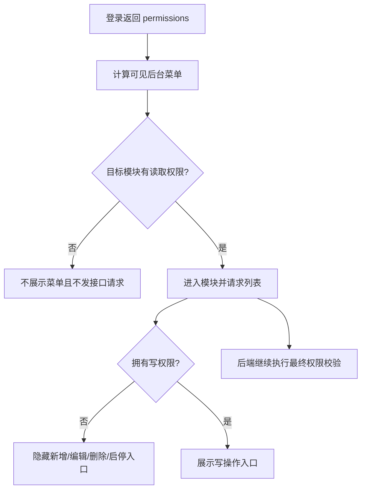

# 管理后台前端权限对齐设计

## 1. 目标

管理后台的菜单、页面数据请求和写操作入口必须与后端权限码一致。没有列表读取权限时不展示对应菜单；没有写权限时不展示新增、编辑、删除、启停等操作入口。后端继续作为最终权限边界，前端仅负责一致的可见性和交互体验。

## 2. 问题与根因

当前前端只用“是否拥有任意 `admin:*` 权限”判断能否进入后台，但 `adminNavItems` 是固定完整列表。因此普通成员虽然只有组织和工具读取权限，仍能看到 AI 日志、操作日志等菜单，并在点击后收到后端 `403 Forbidden`。

权限目录和后端接口拦截器已经包含正确权限码，不需要新增权限点，也不需要放宽接口校验。

## 3. 功能边界

本次包含：

- 后台菜单按读取权限过滤。
- 后台页面切换和分页请求进行权限守卫。
- 后台写操作按钮按写权限隐藏。
- 当前页面失去权限或目标页面不可访问时，回退到第一个可访问页面。
- 概览中的跨模块快捷入口按目标模块权限显示。
- 增加前端权限映射与回归测试。

本次不包含：

- 修改后端权限码、角色数据或接口授权规则。
- 新增菜单管理表或由后端动态下发菜单树。
- 改变现有后台 UI 风格、布局和业务逻辑。

## 4. 权限映射

| 后台模块 | 菜单读取权限 | 写操作权限 |
|---|---|---|
| 概览 | 任意有效 `admin:*` 权限 | 无 |
| 部署门禁 | `admin:deploy:read` | `admin:deploy:approve` |
| 用户管理 | `admin:user:read` | `admin:user:write` |
| 组织架构 | `admin:department:read` | `admin:department:write` |
| 角色权限 | `admin:role:read` | `admin:role:write` |
| 工具管理 | `admin:tool:read` | `admin:tool:write` |
| 模型配置 | `admin:model:read` | `admin:model:write` |
| AI 日志 | `admin:ai-log:read` | 无 |
| 操作日志 | `admin:log:read` | 无 |

普通成员当前拥有 `admin:department:read` 和 `admin:tool:read`，因此后台只展示“概览、组织架构、工具管理”。

## 5. 前端结构

定义唯一的后台模块元数据，每个模块包含 `key`、名称、图标和读取权限。所有以下逻辑共享这份映射：

- `visibleAdminNavItems`：根据当前用户权限生成可见菜单。
- `canReadAdminSection(section)`：判断页面和分页请求是否允许。
- `hasPermission(code)`：判断写操作入口是否显示。
- 后台入口与当前页面回退逻辑。

禁止在模板和事件函数中分别维护另一套权限码，避免再次漂移。

## 6. 页面与请求流程

直接调用 `openAdminSection` 或 `loadAdminPage` 时仍需检查读取权限。即使未来出现新的调用入口，也不能向无权接口发送请求。

## 7. 写操作可见性

- 部署门禁：无 `admin:deploy:approve` 时隐藏提交/处理入口。
- 用户管理：无 `admin:user:write` 时隐藏新增、编辑、重置密码、启停、删除入口。
- 组织架构：无 `admin:department:write` 时隐藏新增一级、编辑、新增下级、启停、删除和保存入口；只保留只读树。
- 角色权限：无 `admin:role:write` 时隐藏新增、编辑、删除和启停入口；列表仍可查看。
- 工具管理：无 `admin:tool:write` 时隐藏状态修改入口。
- 模型配置：无 `admin:model:write` 时隐藏启停和编辑入口。

写入口使用隐藏而非禁用，避免无权限用户看到不可执行的管理动作。后端拦截器仍保留，防止绕过前端。

## 8. 异常与边界条件

- 用户只有一个后台读取权限时，后台入口正常展示，菜单只包含概览和对应模块。
- 用户没有任何 `admin:*` 权限时，保持现有“无后台权限”页面。
- 当前模块权限在会话刷新后消失时，自动切换到第一个可访问模块，不保留无权页面。
- 未知模块或无权模块不会触发 `loadAdminPageApi`。
- 接口因服务端权限变更返回 403 时，仍使用现有统一错误提示，不在前端吞掉异常。

## 9. 验收标准

- 普通成员只看到概览、组织架构、工具管理。
- 普通成员进入后台不会请求 AI 日志、操作日志等无权接口。
- 审计员按现有角色权限看到对应只读模块，但看不到写操作入口。
- 管理员保持全部菜单和操作能力。
- 手动调用无权页面切换函数时不会改变当前模块，也不会发起请求。
- 全量前端测试和生产构建通过，部署后线上静态资源及后端接口正常。

## 10. 性能与复杂度

权限判断基于当前用户权限集合。将权限数组转换为 `Set` 后，单次判断时间复杂度为 `O(1)`；菜单过滤为 `O(m)`，其中 `m` 是固定后台模块数，目前为 9，不产生可感知性能开销。
